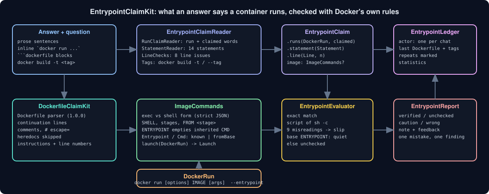
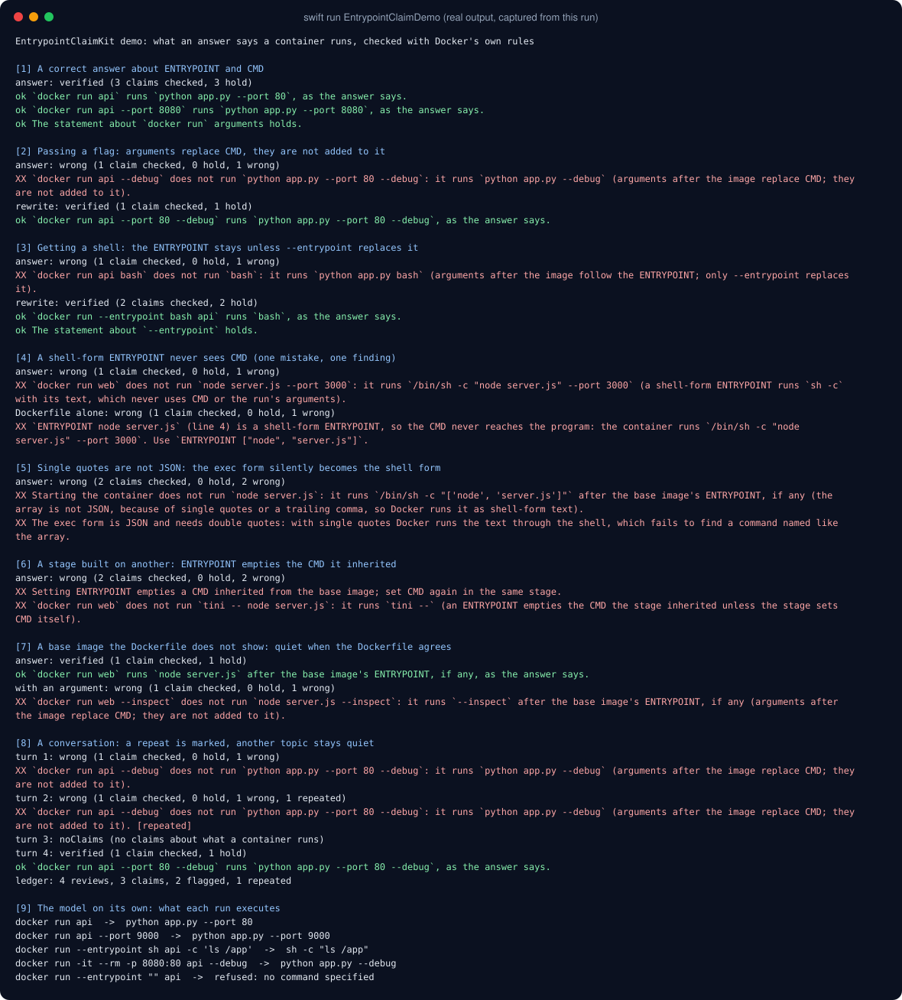
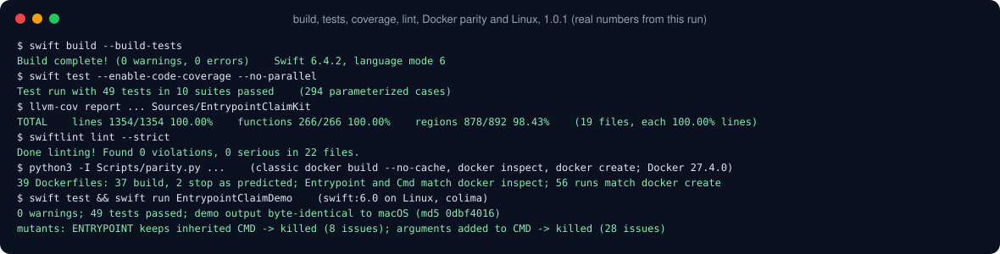

# EntrypointClaimKit



Ask a model how to pass a flag to a container, or how to get a shell in one, and the explanation is often where the
mistakes are. Take a Dockerfile with `ENTRYPOINT ["python", "app.py"]` and `CMD ["--port", "80"]`. The model says
`docker run api --debug` runs `python app.py --port 80 --debug`, but arguments after the image replace `CMD`, so
the port is gone. It says `docker run -it api bash` gives you a shell, but `bash` is handed to `python app.py`. It
writes `ENTRYPOINT node server.js` with a `CMD`, and the `CMD` never reaches node. It writes
`CMD ['node', 'server.js']`, which is not JSON, so Docker runs the text through `/bin/sh` and the container fails
with `[node,: not found`.

All of these build cleanly. They fail only when the container starts.

EntrypointClaimKit reads what an answer says about what a container runs and checks it with the rules Docker
itself uses: how the parser tells the exec form from the shell form, how the builder stores `Entrypoint` and `Cmd`
in the image, and how the daemon combines them with `docker run`'s `--entrypoint` and arguments. It is part of a
series of Swift packages around [ProviderGatewayKit](https://github.com/rajatslakhina/foundation-model-provider-gateway),
and it picks up where [DockerfileClaimKit](https://github.com/rajatslakhina/dockerfile-claim-kit) stops. That kit
checks where files land and what the build sees; this one checks what the image runs.

## Why

A wrong claim about a container's command looks plausible to a reader who has not memorised the exec and shell
forms. Docker's rules here are exact, and they were measured on this Mac rather than recalled:

- **The parser** (shared by the classic builder and BuildKit, read from `moby/buildkit`'s `parseMaybeJSON`): text
  that starts with `[` and is a JSON array of strings is the exec form. Any other text is the shell form. A JSON
  array holding a number stops the build, and so does shell-form text that starts with `--`, because the parser
  reads that word as a flag of the instruction.
- **The builder** (`dispatchCmd` / `dispatchEntrypoint` in both builders): a shell-form line is stored as
  `SHELL` plus its text, `/bin/sh -c "..."` by default. A later line replaces an earlier one. A stage built `FROM`
  an earlier stage starts with that stage's values. `ENTRYPOINT` empties a `CMD` the stage inherited, unless the
  stage set `CMD` before it.
- **The daemon** (`docker create`): `--entrypoint` takes one word, which is never split, and drops the image's
  `CMD`. Arguments after the image replace `CMD`. Whatever `Entrypoint` holds comes first.

`Scripts/parity.py` builds 39 Dockerfiles with the classic `docker build --no-cache` and compares the model with
`docker inspect` (the stored `Entrypoint` and `Cmd`) and with `docker create` (the `Path` and `Args` the daemon
composes for 56 runs). The build cache is always off: during development, one cached build handed back an image
whose `CMD` an earlier build had kept, and that would have taught the model the wrong rule.

## What it checks

- **Runs.** "`docker run api --debug` runs `python app.py --debug`", "the container starts `node server.js`", or
  "This runs `...`" after a `docker run` in a code block. The run must use an image the conversation built
  (`docker build -t api .`). A `docker run nginx` of a base image, `docker exec` and `docker compose run` are left
  alone.
- **Statements.** For example "arguments to `docker run` replace CMD", "`--entrypoint` keeps the CMD", "only the
  last CMD takes effect", "a shell-form ENTRYPOINT ignores CMD", "setting ENTRYPOINT keeps the base image's CMD"
  and "single quotes work in the exec form". There are 14 in all, read only from sentences that name `CMD` or
  `ENTRYPOINT`. A sentence that is negated, conditional, or about compose, Kubernetes, `docker exec` or
  `HEALTHCHECK` is skipped.
- **Lines** of the Dockerfile the answer shows:
  - a shell-form `CMD` under an exec-form `ENTRYPOINT`;
  - an array that is not JSON;
  - an array holding a non-string, or text starting with `--` (the build stops);
  - a shell-form `ENTRYPOINT` with a `CMD`;
  - several `CMD` or `ENTRYPOINT` lines in the final stage;
  - an `ENTRYPOINT` that empties the `CMD` inherited from an earlier stage.

A claim that does not match is re-judged under nine misreadings. When one explains it, the finding names that
**slip**. When none does, the claim is **unchecked**, not wrong.

### The slips it names

| Slip | The misreading |
|---|---|
| `argumentsAppendToCmd` | Arguments after the image read as added to `CMD`: they replace it. |
| `argumentsReplaceEntrypoint` | Arguments read as replacing the `ENTRYPOINT`: they follow it; only `--entrypoint` replaces it. |
| `shellFormTakesArguments` | A shell-form `ENTRYPOINT` read as receiving `CMD` or arguments: `sh -c` takes them as `$0`, `$1`, ... |
| `overrideKeepsCmd` | `--entrypoint` read as keeping the image's `CMD`: it drops it. |
| `overrideIsSplit` | `--entrypoint "sh -c"` read as a command line: Docker looks for one executable named `sh -c`. |
| `entrypointKeepsBaseCmd` | `ENTRYPOINT` read as keeping the `CMD` from the stage it builds on: it empties it. |
| `earlierCmdCounts` | An earlier `CMD` line read as taking effect: only the last one does. |
| `brokenExecForm` | Single quotes or a trailing comma read as the exec form: it is shell-form text. |
| `shellCmdIsWords` | A shell-form `CMD` under an exec-form `ENTRYPOINT` read as plain words: it is stored as `/bin/sh -c "..."`. |

### What the Dockerfile does not say

A Dockerfile that sets no `ENTRYPOINT` inherits its base image's, and many official images ship one (`node`,
`postgres`, `nginx`). The kit never calls a claim wrong because of that unseen prefix. With `FROM node:20` and
`CMD ["node", "server.js"]`, "`docker run web` runs `node server.js`" holds, and the explanation says it runs after
the base image's `ENTRYPOINT`, if any. A claim can still be wrong about the part the Dockerfile does settle:
"`docker run web --inspect` runs `node server.js --inspect`" is wrong, because the argument replaces `CMD` whatever
the base's `ENTRYPOINT` is. A Dockerfile that sets neither line leaves everything to the base, and its runs are
unchecked.

A wrapper `ENTRYPOINT` is treated the same way. That covers one ending in `--` (`["tini", "--"]`), an init such as
`tini` or `dumb-init`, or a lone script (`["/entrypoint.sh"]`). It runs the command it is handed, so
"`docker run -it db bash` starts `bash`" holds. A shell-form `CMD` under such a wrapper is not flagged either.
`["python", "app.py"]` is not a wrapper, and `bash` handed to it is still caught.

In an answer with a "before" and an "after" Dockerfile, each sentence is read against the Dockerfile shown just
above it. Lines are read only from the last one, the answer's final version.

## Install

```swift
dependencies: [
    .package(url: "https://github.com/rajatslakhina/entrypoint-claim-kit.git", from: "1.0.1")
]
```

Then add `.product(name: "EntrypointClaimKit", package: "entrypoint-claim-kit")` to your target. Swift 6, macOS 13,
iOS 16, tvOS 16, watchOS 9 and Linux. It depends on
[`dockerfile-claim-kit`](https://github.com/rajatslakhina/dockerfile-claim-kit) for its Dockerfile parser.

## Usage

````swift
import EntrypointClaimKit

let answer = """
```dockerfile
FROM python:3.12-slim
ENTRYPOINT ["python", "app.py"]
CMD ["--port", "80"]
```
Build it with `docker build -t api .`. Then `docker run api --debug` runs `python app.py --port 80 --debug`.
"""

let report = EntrypointClaimChecker().check(answer, context: "How do I turn on --debug?")
report.verdict        // .wrong
report.note           // "Container command check: `docker run api --debug` does not run
                      //  `python app.py --port 80 --debug`: it runs `python app.py --debug` (arguments after the
                      //  image replace CMD; they are not added to it)."
report.feedback       // a message asking the model to correct exactly that
````

One `EntrypointLedger` per conversation remembers the last Dockerfile shown and the images built, so a later turn
that only says "`docker run api --port 80 --debug` runs ..." is still checked. A wrong claim stated again after a
correction was asked for is marked as repeated:

```swift
let ledger = EntrypointLedger()
let first = await ledger.review(answer, context: question)
let second = await ledger.review(nextAnswer, context: followUp)
second.repeatedCount  // flagged findings the conversation was already told about
```

The model can be used on its own:

```swift
let image = ImageCommands(Dockerfile(text))       // Dockerfile is DockerfileClaimKit's parser
image.entrypoint                                  // .known(["python", "app.py"]) or .fromBase
let launch = image.launch(DockerRun("docker run --entrypoint sh api -c 'ls /app'")!)
launch.words                                      // ["sh", "-c", "ls /app"]
launch.refused                                    // true when Docker would say "no command specified"
```

### Policies

`EntrypointPolicy.standard` reads the Dockerfile's lines and reports cautions. `.lenient` reads only what the
answer states and counts cautions as holding.

## Only when a container command is in view

Nothing is read unless the answer or the question names `CMD` or `ENTRYPOINT`, shows a `docker run`, or shows a
Dockerfile. A run claim also needs a Dockerfile in the conversation and an image the conversation built.
Sentences about cron jobs, Makefiles, CI or Windows `cmd` stay quiet, and so do `RUN` steps and `HEALTHCHECK`
commands. Each of those was probed before tagging.

## How it fits

```
ProviderGatewayKit ── routes the request, returns the answer
        │
        ├── DockerignoreClaimKit ── what reaches the build context
        ├── DockerfileClaimKit ──── where files land, what each step sees
        └── EntrypointClaimKit ──── what the container runs        (this package)
```

In [ai-chat-app](https://github.com/rajatslakhina/ai-chat-app) it runs after the Dockerfile check, on the text
the user will see. A claim that does not hold gets a note under the answer.

## Demo



`swift run EntrypointClaimDemo` runs nine scenarios: a correct answer, passing a flag, getting a shell, a
shell-form `ENTRYPOINT`, single quotes, a stage built on another, an unseen base `ENTRYPOINT`, a four-turn
conversation and the model on its own. The output above is the real output, also in
`Screenshots/demo-output.txt`; two runs are byte-identical, and so is the run on Linux.

## Quality



- `swift build --build-tests`: 0 warnings, 0 errors (Swift 6.4.2, language mode 6).
- `swift test --enable-code-coverage --no-parallel`: **49 tests in 10 suites**, 294 parameterized cases, all
  passing.
- `llvm-cov report`: **100.00% of lines (1354) and functions (266)** on every one of the 19 library files;
  regions 98.43% (878/892). See `Screenshots/coverage.txt`.
- `swiftlint lint --strict`: 0 violations in 22 files, with the `.swiftlint.yml` in this repository (tool-verified).
- Parity: 39 Dockerfiles. The 37 that build match `docker inspect`, and their 56 runs match `docker create`. The 2
  that stop were predicted to stop.
- Linux (`swift:6.0` image, Swift 6.0.3): 0 warnings, 49 tests pass, demo output byte-identical.
- Mutation checks: two mutants, each killed by a failing test run. One keeps an inherited `CMD` under a new
  `ENTRYPOINT` (8 recorded issues). The other adds arguments to `CMD` (28).

## Limits

- **The process is modelled; the program is not.** What an entrypoint script does with `"$@"`, whether a shell
  forwards signals, and which process ends up as PID 1 are not judged. On this Mac's oracle, `dash` (Ubuntu's
  `/bin/sh`) kept the shell as PID 1 for `CMD node server.js`, while `bash` replaced itself with the command.
  The answer rarely says which shell the base image has, so PID 1 and signal claims are left unread.
- **A base image's own `ENTRYPOINT`, `CMD` and `SHELL` are unknown.** Runs on a base the Dockerfile does not
  override are checked only for the part the Dockerfile settles.
- **Only the classic builder was run** (no buildx here). BuildKit's dispatch code was read, and it matches on
  everything modelled except `CMD []` followed by `ENTRYPOINT`. There the classic builder stores `null` and
  BuildKit `[]`; both run nothing extra.
- **Not read:** `docker compose` `command:`/`entrypoint:`, Kubernetes `command`/`args`, `docker exec`,
  `HEALTHCHECK` and `ONBUILD` commands, `--target` builds (the last stage is the image), and runs of images the
  conversation did not build. A `docker run` option the reader does not know makes it skip the run rather than
  guess where the image is.
- `$VAR` inside `CMD`/`ENTRYPOINT` is DockerfileClaimKit's job (`execFormNoShell`, stage `ARG`s), so it is not
  repeated here.

## Versions

- **1.0.1**: a final stage that sets `CMD` again after its `ENTRYPOINT` no longer gets the "empties the
  inherited CMD" caution. A sentence that only mentions a "final stage" is no longer read as "only the last CMD
  counts". Both were found when the series' shared demo ran a correct `tini` answer through 1.0.0.
- **1.0.0**: first release.

## Part of a series

One package a day around ProviderGatewayKit, each checked the same way: 100% line coverage, strict SwiftLint, a
real demo, a fresh-clone check. The record of every run is in
[llm-ecosystem-log](https://github.com/rajatslakhina/llm-ecosystem-log), and all of them run together in
[llm-ecosystem-demo](https://github.com/rajatslakhina/llm-ecosystem-demo).

## License

MIT. See [LICENSE](LICENSE).
